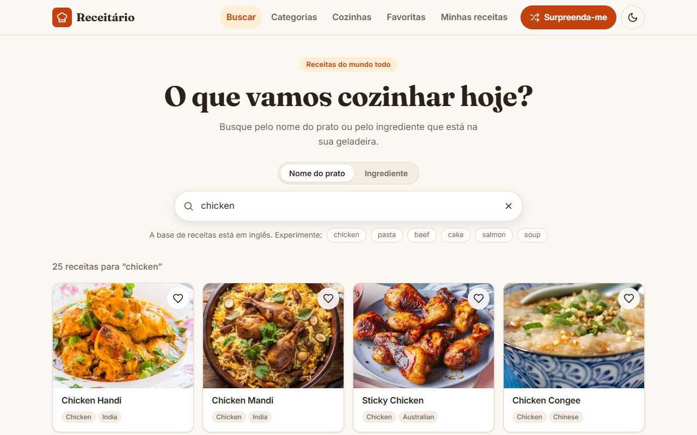

# Receitário — React Recipe Finder

[🇧🇷 Português](README.md) · 🇺🇸 English

A web app to discover recipes from all over the world: search by dish name or by an ingredient you
have at home, browse categories and cuisines, read ingredients and step-by-step instructions, save
favorites and keep a notebook with your own recipes. Recipe data comes from the public
[TheMealDB](https://www.themealdb.com/api.php) API (free test key, no sign-up); everything that belongs
to the user is stored in the browser's `localStorage`.

**Demo:** https://brunoicosta.github.io/react-recipe-finder/



## Features

- Debounced search by name or ingredient, with the query kept in the URL (shareable, back/forward work).
- Categories and cuisines by country, with an instant country filter.
- Recipe page with photo, tags, a checkable ingredient list with measures, numbered steps and the
  YouTube link.
- Favorites in `localStorage`, with a counter in the menu and cross-tab sync.
- "My recipes": create, edit and delete your own recipes in a validated form (React Hook Form + Zod,
  dynamic ingredient list with `useFieldArray`, delete confirmation in a native `<dialog>`).
- "Surprise me" random recipe, loading skeletons, empty/error states with retry, "Show more" paging.
- Dark mode that follows the system, responsive and accessible layout.
- **Portuguese (pt-BR) and English UI** with a PT/EN switcher.

## Stack

React 19.2, TypeScript 5.9 (strict), Vite 7.3, React Router 7.11, React Hook Form 7.70 + Zod 4.3,
i18next 25.7 + react-i18next 16.5 + i18next-browser-languagedetector 8.2, Vitest 4 + Testing Library,
ESLint 9 + Prettier 3. CSS Modules with design tokens — no UI library.

## Internationalization

- Initial language: saved choice (`localStorage` key `receitario:language`) → browser language
  (`pt-*` becomes pt-BR, anything else English) → pt-BR. Switching updates `<html lang>` and the
  document title immediately.
- Typed resources in `src/i18n/locales/<language>/<namespace>.ts`. pt-BR is the source of truth and
  every English file is typed against it, so a missing key fails the build; `t()` keys are checked
  through i18next's `CustomTypeOptions`.
- Zod messages are translation keys, translated when rendered, so one schema serves both languages.
- TheMealDB content stays as the API returns it; categories have labels in both languages and cuisines
  are mapped to ISO region codes and named with `Intl.DisplayNames`. Dates and numbers use `Intl`
  with the active locale.
- To add a language: copy `src/i18n/locales/en/`, translate it, register it in `resources.ts` and
  `SUPPORTED_LANGUAGES`, and add its name to the `LanguageSwitcher`.

## Running locally

```bash
npm install
npm run dev      # http://localhost:5173
npm test         # Vitest
npm run lint
npm run build
npm run preview  # http://localhost:4173/react-recipe-finder/
```

## Author

Bruno Vinicius Isaac Costa — https://github.com/BrunoICosta · [MIT](LICENSE) license.
