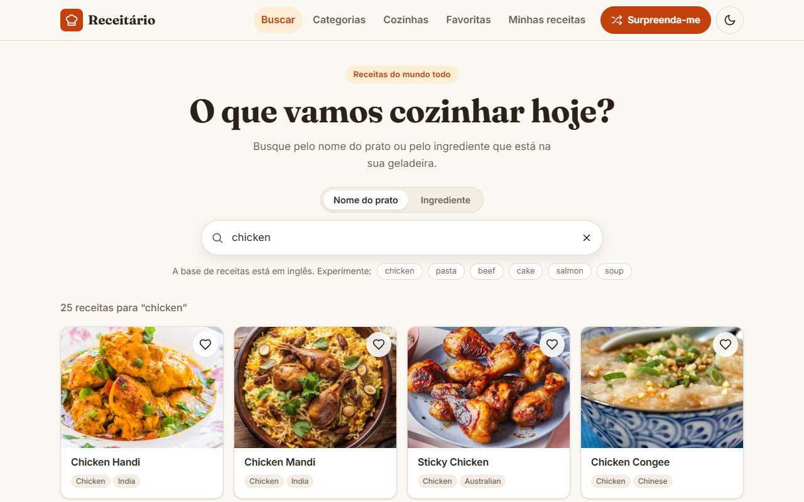

# Receitário — React Recipe Finder

🇧🇷 Português · [🇺🇸 English](README.en.md)

Aplicação web para descobrir receitas do mundo todo: busque pelo nome do prato ou pelo ingrediente que
você tem em casa, navegue por categorias e cozinhas, veja ingredientes e modo de preparo passo a passo,
salve suas favoritas e mantenha um caderno com as suas próprias receitas. Os dados vêm da API pública
[TheMealDB](https://www.themealdb.com/api.php) (chave de teste gratuita, sem cadastro) e tudo o que é do
usuário fica salvo no `localStorage` do navegador.

**Demo:** https://portfolio.brunoisaac.dev/react-recipe-finder/



## Funcionalidades

- **Busca com debounce** por nome do prato ou por ingrediente, com a consulta refletida na URL
  (`?q=…&por=ingrediente`) — dá para compartilhar o link e usar voltar/avançar do navegador.
- **Categorias** (com nomes traduzidos) e **cozinhas por país**, com filtro instantâneo da lista de países.
- **Página da receita** com foto, categoria, país, tags, lista de ingredientes com medidas (marcável,
  para usar na hora das compras) e modo de preparo em etapas numeradas, além do link para o vídeo no YouTube.
- **Favoritas** persistidas no `localStorage`, com contador no menu e sincronização entre abas.
- **Minhas receitas**: criar, editar e excluir receitas próprias em um formulário validado
  (React Hook Form + Zod), com lista dinâmica de ingredientes (`useFieldArray`) e confirmação de exclusão.
- **Surpreenda-me**: abre uma receita aleatória.
- Skeletons de carregamento, estados vazios e de erro com "Tentar novamente", paginação "Mostrar mais"
  para listas longas.
- **Interface em português (pt-BR) e inglês**, com seletor de bandeiras (Brasil/EUA) no menu, detecção do idioma do
  navegador e categorias/países traduzidos.
- **Tema escuro** que segue o sistema, com alternância manual salva e aplicada antes da primeira pintura.
- Layout responsivo (mobile first) e acessível: link "pular para o conteúdo", foco visível, rótulos e
  mensagens de erro associados aos campos, `aria-pressed`, `aria-live` e diálogo modal nativo.

## Stack

| Tecnologia                                                     | Versão            |
| -------------------------------------------------------------- | ----------------- |
| React / React DOM                                              | 19.2              |
| TypeScript (strict)                                            | 5.9               |
| Vite + @vitejs/plugin-react                                    | 7.3 / 5.1         |
| React Router                                                   | 7.11              |
| React Hook Form + @hookform/resolvers                          | 7.70 / 5.2        |
| Zod                                                            | 4.3               |
| i18next + react-i18next + i18next-browser-languagedetector     | 25.7 / 16.5 / 8.2 |
| Vitest + Testing Library (React, user-event, jest-dom) + jsdom | 4.0 / 16.3 / 27.4 |
| ESLint (typescript-eslint, react-hooks) + Prettier             | 9.39 / 3.7        |

CSS Modules com design tokens em CSS custom properties — nenhuma biblioteca de UI.

## Arquitetura e decisões

- **Organização por feature** (`features/search`, `features/recipe`, `features/my-recipes`…), com
  `core` para infraestrutura (cliente HTTP, hooks genéricos, tema) e `shared` para componentes de UI
  reutilizáveis. Cada página é carregada sob demanda com `React.lazy` + `Suspense`, então quem só busca
  receitas não baixa o Zod nem o React Hook Form.
- **Cliente de API tipado** (`core/api`): os payloads crus da TheMealDB (com `strIngredient1…20`,
  `meals: null` etc.) são convertidos em um modelo de domínio limpo (`Recipe`, `RecipeSummary`). A
  normalização transforma o texto livre de instruções em etapas, remove marcadores como "STEP 1" e "▢",
  e trata a mudança recente da API de "área" para "país". Respostas de dados de referência ficam em cache
  na memória, e o resultado do sorteio já alimenta o cache da página de detalhe.
- **`useAsync`** em vez de uma biblioteca de data fetching: cancela a requisição anterior com
  `AbortController` (nada de resposta antiga sobrescrevendo a nova) e deriva o estado de carregamento em
  vez de chamar `setState` dentro do efeito, seguindo as regras do `eslint-plugin-react-hooks` 7.
- **`useLocalStorage`** baseado em `useSyncExternalStore`: todos os componentes que usam a mesma chave
  compartilham o valor (o contador de favoritas no menu atualiza na hora), outras abas são sincronizadas
  pelo evento `storage`, e os dados lidos passam por validação — no caso das receitas do usuário, pelo
  mesmo schema Zod do formulário, descartando só o item corrompido.
- **URL como fonte da verdade da busca** (`useSearchQuery`): o campo responde a cada tecla, a URL recebe
  o termo com debounce e o fetch reage à URL.
- **Formulário** com React Hook Form + `zodResolver`: o schema é a única fonte das regras e dos tipos
  (`z.input`/`z.output`), os erros são anunciados via `aria-describedby` e o foco vai para o primeiro
  campo inválido.
- **Sem biblioteca de UI**: tokens de cor/espaçamento em CSS custom properties com variação escura via
  `data-theme`, ícones SVG inline e `<dialog>` nativo para a confirmação.

## Internacionalização

A interface está em **português (pt-BR, padrão)** e **inglês (en)**, com
[i18next](https://www.i18next.com/) + [react-i18next](https://react.i18next.com/).

- **Idioma inicial**: escolha salva (`localStorage`, chave `receitario:language`) → idioma do
  navegador (qualquer `pt-*` vira pt-BR, qualquer outro vira inglês) → pt-BR. A troca pelo seletor
  de bandeiras do menu é salva, atualiza `<html lang>` e o título da aba na hora, sem recarregar.
- **Recursos tipados** (`src/i18n/locales/<idioma>/<namespace>.ts`): um arquivo por namespace
  (`common`, `search`, `recipe`, `browse`, `favorites`, `myRecipes`, `taxonomy`). O pt-BR é a
  fonte da verdade: cada arquivo em inglês é tipado como `typeof` do equivalente em português e o
  `CustomTypeOptions` do i18next (`src/i18n/i18next.d.ts`) faz `t('chave')` ser verificado pelo
  TypeScript — chave faltando ou digitada errado quebra o build.
- **Validação**: as mensagens do schema Zod são chaves (`validation.tooLong:40`), traduzidas na hora
  de exibir por `useValidationMessage`; o mesmo schema serve aos dois idiomas e os erros já visíveis
  mudam de idioma junto com a interface.
- **Dados da TheMealDB** ficam como a API devolve (nomes de pratos, ingredientes e instruções em
  inglês). Os enums são mapeados: categorias têm rótulos nos dois idiomas e as ~190 cozinhas são
  ligadas a códigos ISO de país (`shared/utils/cuisineRegions.ts`) e nomeadas com
  `Intl.DisplayNames` no idioma ativo ("Japanese" → "Japão" / "Japan"). Datas e números usam `Intl`
  com o locale ativo.

**Como adicionar um idioma** (ex.: espanhol):

1. Copie `src/i18n/locales/en/` para `src/i18n/locales/es/` e traduza os textos (o TypeScript aponta
   qualquer chave faltando).
2. Registre os arquivos em `src/i18n/resources.ts` e adicione `'es'` em `SUPPORTED_LANGUAGES`
   (`src/i18n/index.ts`), ajustando `toSupportedLanguage` para mapear `es-*`.
3. Inclua o nome do idioma em `LANGUAGE_NAMES` (`src/app/layout/LanguageSwitcher.tsx`) e as
   categorias em `taxonomy.ts` — os países já saem traduzidos pelo `Intl.DisplayNames`.

## Como rodar

Pré-requisito: Node.js 22+.

```bash
npm install
npm run dev          # http://localhost:5173
npm test             # testes unitários e de componentes (Vitest)
npm run lint         # ESLint
npm run build        # build de produção em dist/
npm run preview      # serve o build em http://localhost:4173/react-recipe-finder/
```

## Deploy

Publicado na Cloudflare (Workers static assets) em
https://portfolio.brunoisaac.dev/react-recipe-finder/ pelo pipeline do repositório
[portfolio](https://github.com/BrunoICosta/portfolio), que roda `npm ci && npm run build:cf` e publica
a pasta `dist/` (gerada com o base path `/react-recipe-finder/`). Neste repositório, o workflow de CI
roda formatação, lint, testes e build a cada push e pull request.

## Estrutura de pastas

```
src/
├── app/                 # roteador, layout (header, tema), páginas 404 e de erro
├── core/
│   ├── api/             # cliente TheMealDB, tipos crus e normalização
│   ├── hooks/           # useAsync, useDebounce, useLocalStorage, useDocumentTitle
│   ├── models/          # modelo de domínio (Recipe, Category…)
│   └── theme/           # preferência de tema claro/escuro
├── i18n/                # configuração do i18next, recursos pt-BR/en e useTaxonomy
├── features/
│   ├── browse/          # categorias e cozinhas
│   ├── favorites/       # favoritas (store, botão, página)
│   ├── my-recipes/      # schema Zod, store e páginas das receitas do usuário
│   ├── random/          # botão "Surpreenda-me"
│   ├── recipe/          # página e componentes de detalhe
│   └── search/          # busca por nome/ingrediente
├── shared/              # componentes, hooks e utilitários reutilizáveis
├── styles/              # tokens e estilos globais
└── test/                # setup do Vitest, fixtures e helpers de render
```

## Próximos passos

- Lista de compras combinando ingredientes de várias receitas.
- Upload de foto (IndexedDB) e exportação/importação das receitas do usuário em JSON.
- Tradução automática das instruções e ingredientes vindos da API.
- Testes end-to-end com Playwright e PWA para uso offline.

## Autor

Bruno Vinicius Isaac Costa — https://github.com/BrunoICosta

Licença [MIT](LICENSE).
